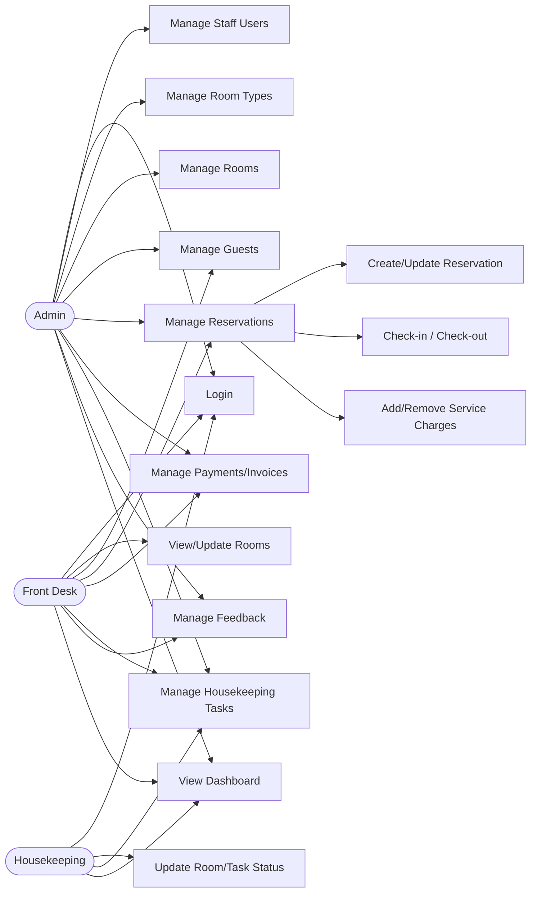
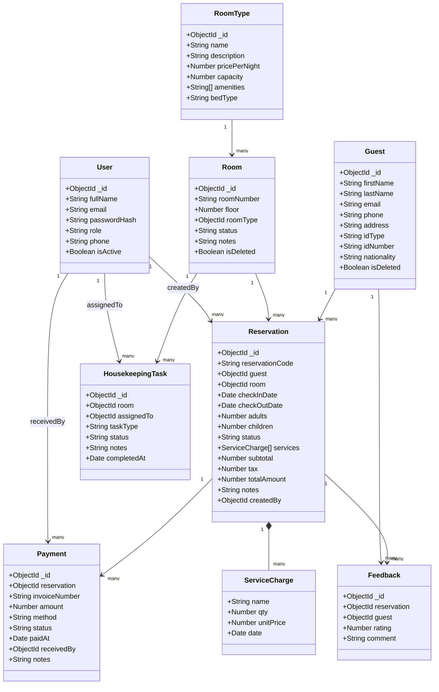
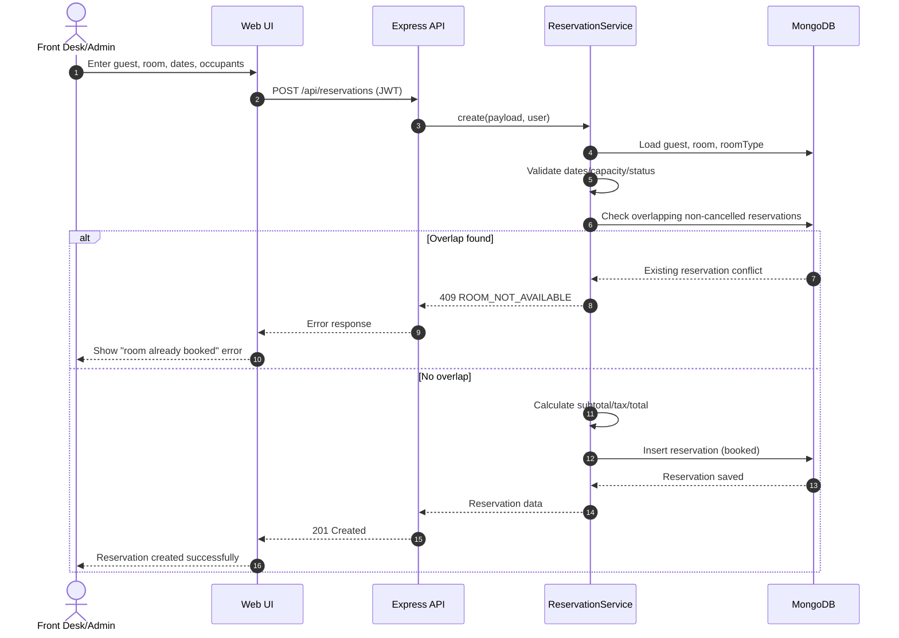
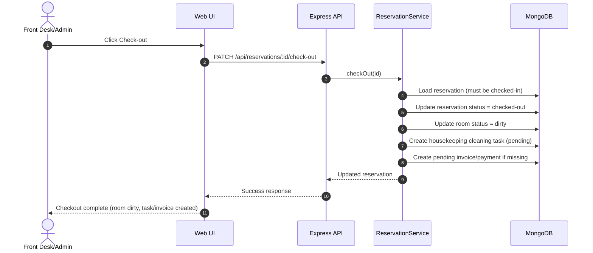
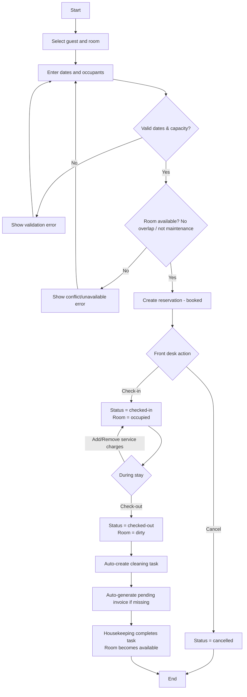

# UML Diagrams
## Marriott Hotel Management System (MHMS)

The diagrams below use Mermaid syntax and reflect the implemented MHMS modules and workflows.

## 1. Use Case Diagram (Simplified)

## 2. Class Diagram (Domain Model)

## 3. Sequence Diagram - Create Reservation (No Double Booking)

## 4. Sequence Diagram - Check-out Workflow

## 5. Activity Diagram - Reservation Lifecycle

